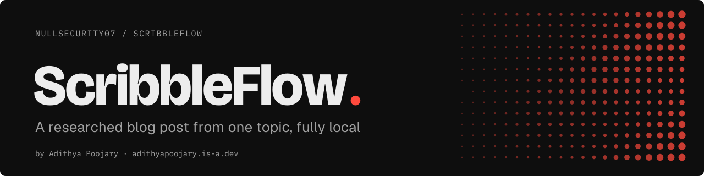
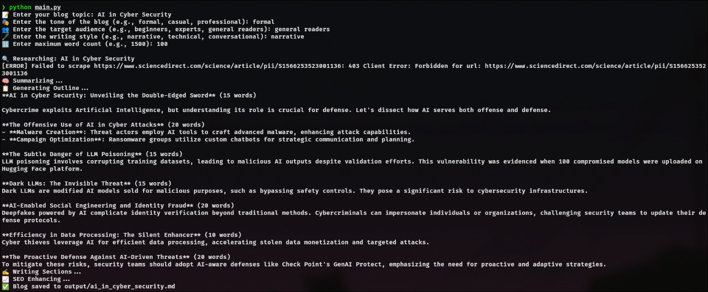

<p align="center"><a href="https://adithyapoojary.is-a.dev/work/scribbleflow/"><picture><source media="(prefers-color-scheme: light)" srcset=".github/readme/banner-light.svg"></picture></a></p>
<p align="center"><picture><source media="(prefers-color-scheme: light)" srcset=".github/readme/badges-light.svg"></picture></p>

ScribbleFlow turns one topic into a researched, SEO-ready blog post in Markdown, from your terminal, on a local model. For writers and builders who want a first draft without an API key or sending anything to the cloud.

<p align="center"></p>

## Highlights

- **Researches first.** Searches DuckDuckGo, scrapes the top results with BeautifulSoup, and summarises them before writing a word.
- **You set the brief.** Topic, tone, audience, writing style and a word limit, asked at the prompt.
- **Outline, then sections.** Builds an outline, drafts each section against it, then runs an SEO pass on the full draft.
- **Local only.** Talks to Ollama on your machine. No API key, no account.
- **Swappable parts.** Research, writing and prompts live in separate files, and the model is one line in `ollama_client.py`.

## How it works

1. `main.py` asks for topic, tone, audience, style and word count.
2. `research.py` searches DuckDuckGo and scrapes paragraph text from the results.
3. `writer.py` summarises the research, generates an outline and expands it section by section.
4. An SEO pass rewrites the draft for keywords and structure.
5. The post is saved to `output/<topic>.md`.

## Quick start

Needs Python 3.10+ and [Ollama](https://ollama.com) running with a model pulled.

```bash
git clone https://github.com/NullSecurity07/ScribbleFlow.git
cd ScribbleFlow
pip install requests beautifulsoup4
ollama pull deepseek-r1
```

Set the model and endpoint at the top of `ollama_client.py`:

```python
OLLAMA_MODEL = "deepseek-r1"
OLLAMA_URL = "http://localhost:11434/api/generate"
```

Then run:

```bash
python main.py
```

## Project layout

```
main.py            interactive CLI and pipeline
research.py        DuckDuckGo search and scraping
writer.py          summary, outline, sections, SEO pass
prompts.py         prompt templates
ollama_client.py   model name and Ollama endpoint
assets/            screenshots
```

## Status

Working prototype. Next: a `requirements.txt` and reading the model from an environment variable instead of editing `ollama_client.py`.

## Built by

Built by [Adithya Poojary](https://adithyapoojary.is-a.dev), founder of ThreatScope. [More projects](https://adithyapoojary.is-a.dev/work/) · [LinkedIn](https://www.linkedin.com/in/adithyapoojary/)

## License

MIT
