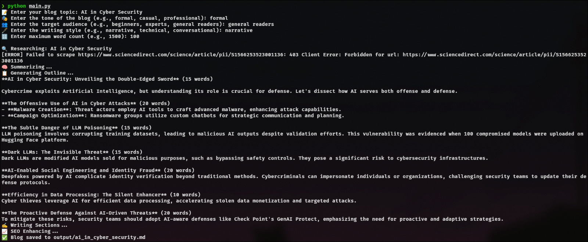
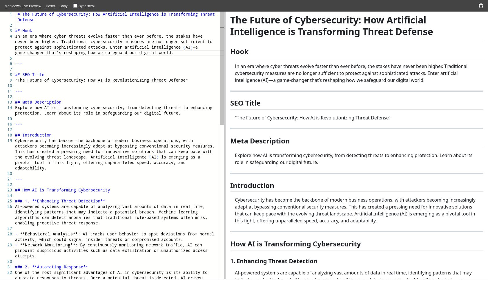
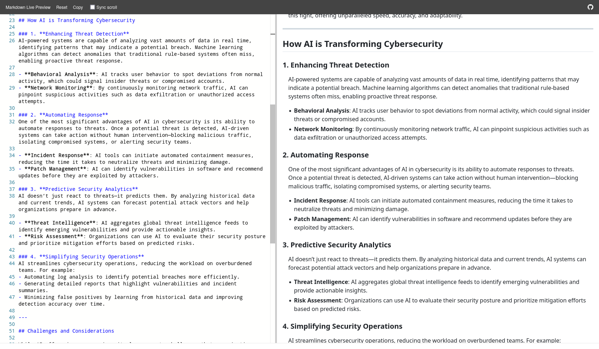
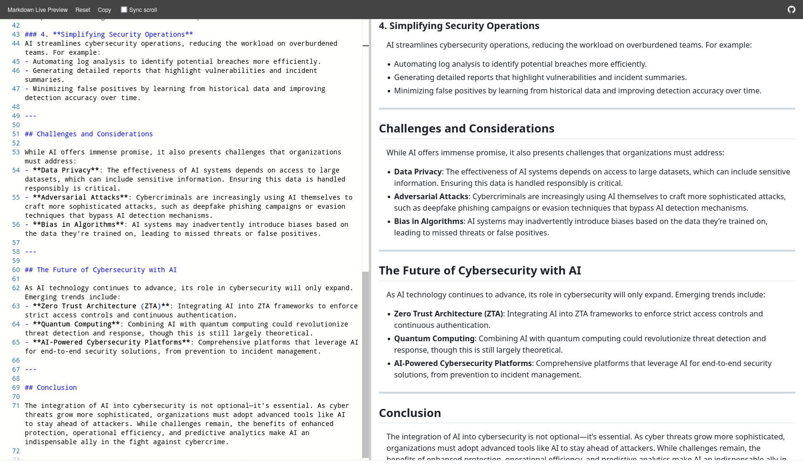
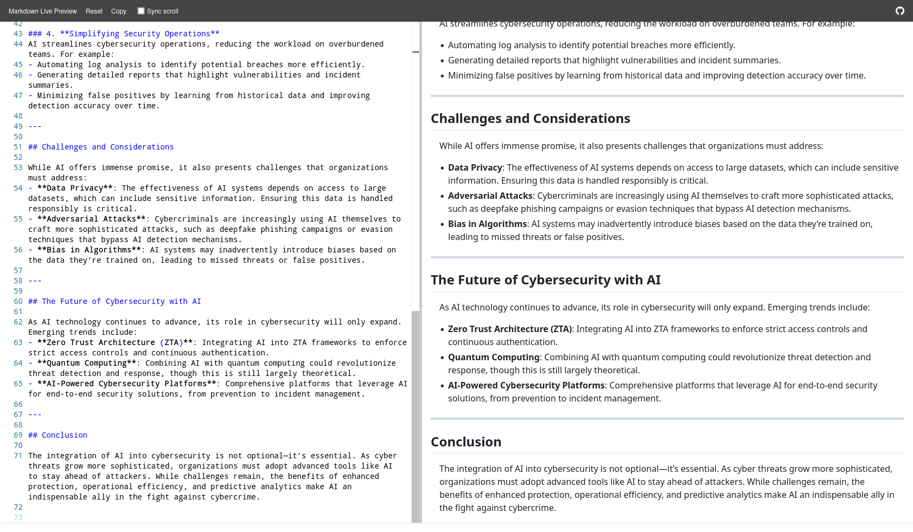

<div align="center">


</div>

<br/>

<div align="center">

*From raw idea to fully researched, LLM-drafted, SEO-optimized markdown — entirely from your terminal.*
*No API key. No cloud. No data leaving your machine.*

</div>

<br/>

<div align="center">

</div>

<br/>

<div align="center">

### — Overview —

</div>

<br/>

ScribbleFlow automates the full blog-writing pipeline using local LLMs and live web research. You provide a topic, tone, audience, writing style, and word count. It handles everything else — research, outline, section drafting, SEO enhancement, and markdown export.

The architecture is modular by design. Research, writing, and prompt logic are discrete, independently swappable components. Changing the underlying model is a one-line config change.

<br/>

<div align="center">

</div>

<br/>

<div align="center">

### — Pipeline —

</div>

<br/>

```
Input (topic, tone, audience, style, word count)
    └─ research.py     →   DuckDuckGo search + BeautifulSoup scraping
    └─ writer.py       →   LLM-based outline + section drafting
    └─ prompts.py      →   Prompt layer (model-agnostic, swappable)
    └─ SEO pass        →   Keyword integration and structure optimization
    └─ output/         →   Clean .md file
```

<br/>

| Module | Function |
|:---|:---|
| `research.py` | DuckDuckGo search + web scraping via BeautifulSoup |
| `writer.py` | LLM-based outline generation and section drafting |
| `prompts.py` | Prompt templates — separated from execution, model-agnostic |
| `ollama_client.py` | Ollama inference interface — configure model and endpoint here |
| `output/` | Final markdown export destination |

<br/>

<div align="center">

</div>

<br/>

<div align="center">

### — Demo —

</div>

<br/>

**CLI**



<br/>

**Output samples**


<br/>

<br/>

<br/>


<br/>

<div align="center">

</div>

<br/>

<div align="center">

### — Installation —

</div>

<br/>

**Requirements**

- Python 3.10+
- [Ollama](https://ollama.com/) running locally with your preferred model pulled

<br/>

```bash
git clone https://github.com/NullSecurity07/ScribbleFlow.git
cd ScribbleFlow
pip install -r requirements.txt
```

<br/>

Configure your model in `ollama_client.py`:

```python
OLLAMA_MODEL = "deepseek-llm"   # or phi3, qwen2.5, mistral, etc.
OLLAMA_URL   = "http://localhost:11434/api/generate"
```

<br/>

<div align="center">

</div>

<br/>

<div align="center">

### — Usage —

</div>

<br/>

```bash
python main.py
```

<br/>

You'll be prompted for:

| Input | Example |
|:---|:---|
| Blog Topic | `The future of local AI inference` |
| Tone | `conversational` · `formal` · `opinionated` |
| Audience | `developers` · `founders` · `general` |
| Writing Style | `technical` · `narrative` · `listicle` |
| Max Word Count | `1500` |

The final `.md` file is saved to `output/`.

<br/>

<div align="center">

</div>

<br/>

<div align="center">

### — Stack —

</div>

<br/>

| Technology | Purpose |
|:---|:---|
| Python 3.10+ | Core runtime |
| Ollama | Local LLM inference — DeepSeek, Phi-3, Qwen, Mistral |
| BeautifulSoup | Web scraping and content extraction |
| DuckDuckGo HTML Search | Live web research without API keys |
| Markdown | Clean, portable output format |

<br/>

<div align="center">

</div>

<br/>

<div align="center">

### — Contributing —

</div>

<br/>

Pull requests are welcome. For feature ideas or bugs, open an issue or reach out directly.

<br/>

<div align="center">

*Built by [Adithya Poojary](https://github.com/NullSecurity07)*
&nbsp;·&nbsp;
[LinkedIn](https://www.linkedin.com/in/adithyapoojary/)
&nbsp;·&nbsp;
[nullsec0001@proton.me](mailto:nullsec0001@proton.me)

<br/>


</div>
